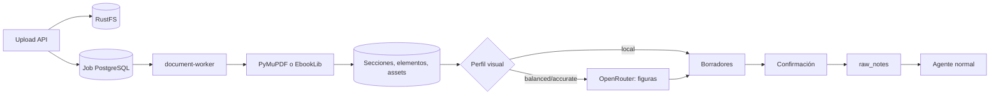

# Procesamiento documental: handoff y estado actual

Este archivo nació como transferencia arquitectónica desde Proyecto SLM. La función ya fue implementada; se conserva para registrar procedencia, decisiones y diferencias entre la propuesta y el sistema real.

Estado contrastado: 10 de octubre de 2026. Los commits de Proyecto SLM son contexto histórico, no dependencias de ejecución ni pruebas de capacidades actuales de Concat Notes.

## Objetivo original

Aceptar PDF y EPUB y permitir:

1. procesar el documento completo;
2. elegir capítulos/subcapítulos declarados o inferidos;
3. elegir rangos físicos de páginas PDF;
4. revisar la extracción antes de crear notas;
5. mantener trabajo local y usar visión remota sólo cuando aporte valor.

## Referencia histórica

Proyecto SLM propuso un pipeline `layout-first, vision-on-demand` en los commits `54b9125` y `eb8b4c4`. La idea reutilizada fue separar original, representación estructurada, proyección Markdown, routing visual y jobs persistentes. No se copiaron SQLite, Ollama, rutas locales de assets ni PaddleOCR-VL obligatorio.

## Implementación actual en Concat Notes



### Entregado

- Servicio `document-worker` Python 3.12 con polling, heartbeat, cancelación, reintento y recuperación.
- Originales, thumbnails y figuras en RustFS.
- Estado y representación en PostgreSQL.
- PDF mediante PyMuPDF; OCR local Tesseract `spa+eng`; tablas a Markdown.
- EPUB mediante EbookLib y BeautifulSoup, con saneamiento y orden XHTML.
- Documento completo, árbol de capítulos con descendientes/exclusiones y rangos PDF normalizados.
- Borradores editables con curso, módulo, clase, Markdown, imágenes y notas propias.
- Rol independiente `document_vision` y perfiles Local/Equilibrado/Preciso.
- Estimación de coste y aprobación por encima de USD 1.
- Límites de 100 MB y 1000 páginas.
- Reutilización por SHA-256 y assets enlazados sin duplicar el objeto.

### Diferencias frente a la propuesta

- No se integró Docling: se usa PyMuPDF con detección de tablas y heurísticas.
- No se integró PaddleOCR: Tesseract es el OCR local.
- El routing visual usa dimensiones/área y deduplicación SHA-256; no es un clasificador semántico local.
- PDF conserva la página, pero añade las figuras al final del bloque de página; EPUB conserva mejor el orden.
- La representación guarda `bbox_json`, pero el extractor actual no reconstruye Markdown por coordenadas finas.
- No existe caché multimodal independiente por prompt/contexto; la deduplicación actual opera por asset dentro de la ejecución.

## Contrato de selección

```json
{"mode":"full"}
```

```json
{
  "mode": "sections",
  "section_ids": ["uuid"],
  "include_descendants": true,
  "excluded_section_ids": []
}
```

```json
{
  "mode": "pages",
  "ranges": [{"start": 10, "end": 18}]
}
```

Las páginas son uno-basadas y físicas. Los rangos se validan, ordenan y fusionan. EPUB no presenta páginas ficticias.

## Persistencia

- `source_documents`: original y metadata.
- `document_sections`: jerarquía navegable.
- `document_elements`: párrafos, headings, tablas y figuras.
- `document_assets`: thumbnails/figuras y descripción visual.
- `document_jobs`: estado operativo.
- `document_runs`: selección, modelo, coste y perfil.
- `document_drafts`: extracción revisable y vínculo a `raw_notes`.

El Markdown documental es extracción fiel, no nota sintetizada. Sólo al confirmar se crea una nota cruda que entra al pipeline LangGraph.

La síntesis posterior usa el formato Markdown clásico de Clases, glosario y flashcards. No implica generación Cornell basada en las notas favoritas. El perfil Local desactiva visión documental, no las llamadas de síntesis posteriores al confirmar. El chat de Mis notas y el agente global son flujos independientes.

## Seguridad y privacidad

- Validación de formato, límites y ZIP traversal.
- Temporales eliminados en `finally`.
- Scripts, iframes y estilos EPUB no se renderizan.
- El binario completo no se manda a OpenRouter.
- Sólo candidatas visuales acotadas se envían en perfiles remotos.
- API keys permanecen en variables de entorno y no deben aparecer en jobs o respuestas.

## Deuda técnica documentada

- Routing visual semántico local y detección robusta de logos/decoraciones.
- Posición PDF por bloques y coordenadas.
- OCR/layout avanzado opcional tras benchmark.
- Caché visual por imagen, modelo, prompt y contexto.
- Más fixtures reales de PDF escaneado, fórmulas, tablas y EPUB complejos.
- Métricas detalladas de tokens, latencia y cache hits.

Esta deuda corresponde a la extracción/visión documental. La generación v2 ya tiene presupuestos y métricas por solicitud, descritos en [generación eficiente](docs/generation-efficiency.md); no atribuirlos automáticamente al cliente HTTP del document-worker.

La guía operativa vigente está en [document-worker/README.md](document-worker/README.md); la arquitectura del agente posterior está en [docs/agent-architecture.md](docs/agent-architecture.md).
