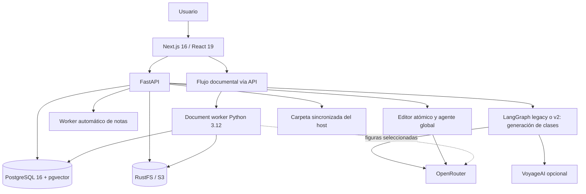

# Concat Notes

Suite de aprendizaje para capturar material de cursos, convertirlo en notas estructuradas, mantener glosarios y flashcards, estudiar con repetición espaciada y exportar el conocimiento a Markdown. Combina procesamiento local determinista con modelos consumidos mediante OpenRouter.

Estado contrastado con el código de esta rama el 10 de octubre de 2026. Las iniciativas pendientes están en [Planes a futuro](PLANES-A-FUTURO.md); las validaciones no garantizan precisión semántica absoluta.

## Capacidades actuales

- **Clases:** captura manual, documentos, cola y archivo por curso; regeneración selectiva de contenido, glosario y flashcards con instrucciones adicionales.
- **Editor Cornell:** documento JSON versionado de dos carriles, bloques relacionados, historial y edición manual o asistida mediante patches revisables.
- **Mis notas:** notas independientes o complementarias organizadas por colecciones y etiquetas.
- **Documentos:** importación de PDF y EPUB completos, por capítulos/subcapítulos o por rangos físicos de páginas PDF; vista previa y confirmación antes de crear notas.
- **Flashcards:** índice propio compatible con el Markdown de Spaced Repetition, filtros, edición, estudio, historial y exportación CSV o Anki `.apkg`.
- **Sincronización:** un Markdown concatenado por curso en una carpeta montada del host, con nombres normalizados, hashes y resolución explícita de conflictos.
- **Agente:** chat persistente con imágenes, consejos de estudio, análisis de duplicados y propuestas revisables sobre notas, glosario, tarjetas y RAG.
- **RAG:** inspección, edición y borrado de fragmentos o embeddings derivados, con reindexado explícito.
- **Administración:** selección de modelos por función, metas de estudio, embeddings, respaldo y restauración de PostgreSQL y RustFS.

## Arquitectura



### Servicios de Docker Compose

| Servicio | Contenedor | Función | Puerto |
|---|---|---|---|
| `frontend` | `proyecto_notas_frontend` | Interfaz Next.js | `3000` |
| `backend` | `proyecto_notas_backend` | API, agente y worker de notas | `8000` |
| `document-worker` | `proyecto_notas_document_worker` | Parsing/OCR persistente de PDF y EPUB | interno |
| `db` | `proyecto_notas_db` | PostgreSQL y pgvector | `5432` |
| `db-migrate` | `proyecto_notas_db_migrate` | Migraciones aditivas; servicio temporal | interno |
| `rustfs` | `proyecto_notas_storage` | Objetos S3 | `9000`, consola `9001` |

PostgreSQL usa `pgdata` y RustFS usa `rustfsdata`. Recrear los servicios de aplicación no borra esos datos. `docker compose down -v` sí elimina los volúmenes y no debe usarse durante una actualización normal.

## Flujos principales

```text
Entrada manual o borrador documental
  -> raw_notes (pending)
  -> análisis de imágenes ordinarias
  -> pipeline LangGraph seleccionado
  -> cuerpo Markdown clásico + glosario + flashcards
  -> processed_notes.structured_markdown y documento/revisión compatible
  -> memoria/embeddings, glosario y flashcards
  -> concatenación y sincronización opcional
```

La interfaz permite procesar inmediatamente. El worker del backend también procesa pendientes cuando hay al menos tres o cuando la más antigua supera diez minutos.

Clases genera Markdown clásico con emojis, no la antigua Metodología de composición basada en notas favoritas. Mis notas conserva Cornell: grid de dos columnas, separadores compartidos, relaciones y JSON editable. El dock tiene seis secciones: Clases, Mis notas, Flashcards, Agente, Sincronización y RAG; `/editor/[id]` abre el editor compartido.

V2 compara evidencia con clases anteriores del mismo curso y preserva aplicaciones/ampliaciones relevantes. No tiene un Critic LLM separado ni fallback automático a legacy ante errores; legacy sigue seleccionable. Los trabajos de regeneración son persistentes y guardan cada clase con sus derivados en una transacción, conservando componentes no seleccionados. Un fallo deja la nota anterior intacta. Los locks son de proceso, no una coordinación distribuida entre réplicas.

Para documentos:

```text
Subida -> RustFS -> inspección local -> selección del usuario
       -> extracción local -> visión remota opcional
       -> borrador editable -> confirmación -> raw_notes
```

El `document-worker` usa PyMuPDF, EbookLib, BeautifulSoup, Pillow y Tesseract. El archivo completo no se envía al proveedor de IA. OpenRouter sólo recibe figuras candidatas en los perfiles Equilibrado/Preciso y el texto cuando se ejecuta la síntesis normal. El perfil Local evita visión documental remota.

## Agente y modelos

Las preferencias de modelos viven en `user_settings`:

| Rol | Responsabilidad |
|---|---|
| `synthesis` | Cuerpo pedagógico y redacción final |
| `query_expansion` | Consultas RAG, evidencia, entidades y suplementos |
| `image_analysis` | Imágenes añadidas a notas manuales |
| `document_vision` | Figuras extraídas de PDF/EPUB |

OpenRouter transporta generación y visión. VoyageAI es opcional para embeddings de 1024 dimensiones; sin credencial se conservan vectores dummy marcados para reprocesamiento.

Composición/visión: `google/gemini-3.8-flash`, `qwen/qwen3.8-flash`, `z-ai/glm-5.3-flash` y `deepseek/deepseek-v4-flash-vision-exp`. Auxiliares: `deepseek/deepseek-v4-flash-0731` (texto) y `google/gemini-3.5-flash-lite` (texto/visión). El catálogo establece capacidades/roles; la disponibilidad real depende de la cuenta y el endpoint. No hay transporte Google directo activo en este catálogo.

Generación usa streaming interno, presupuestos por tarea/tamaño y métricas por solicitud; no persiste respuestas parciales. Son límites por llamada, no una garantía de duración total ni de ausencia absoluta de repetición. Parsing/OCR, validación, patches, scheduler y sincronización son locales; interpretación por LLM y embeddings reales son remotos.

## Inicio rápido

Requisito principal: Docker con Compose. Node.js y `uv` sólo son necesarios para desarrollo fuera de Docker.

1. Crea `backend/.env` desde `backend/.env.template`.
2. Opcionalmente crea `.env` en la raíz y define `NOTES_SYNC_PATH`.
3. Ejecuta:

```bash
docker compose up --build -d
```

- Aplicación: <http://localhost:3000>
- API y Swagger: <http://localhost:8000/docs>
- Consola RustFS: <http://localhost:9001>

```bash
docker compose ps
docker compose logs -f backend document-worker
docker compose down                 # conserva los volúmenes
```

Uso privado: Compose expone puertos/credenciales de desarrollo y la API no tiene autenticación general ni aislamiento multiusuario. CORS no es autorización. No publicar directamente en Internet.

El navegador usa `http://localhost:8000`, incorporado al build, y localhost para imágenes. Abrir sólo el puerto 3000 desde otra máquina no basta. Para acceso privado, ejecutar allí:

```bash
ssh -N -L 127.0.0.1:3000:127.0.0.1:3000 \
  -L 127.0.0.1:8000:127.0.0.1:8000 \
  -L 127.0.0.1:9000:127.0.0.1:9000 usuario@IP_PRIVADA_DEL_SERVIDOR
```

Abrir `http://localhost:3000` en esa máquina. Los servicios deben estar escuchando en el servidor. Cambiar la URL pública exige reconstruir frontend y revisar CORS y RustFS.

## Desarrollo y pruebas

```bash
cd backend
uv sync --frozen
uv run python -m unittest discover -s tests -q

cd ../document-worker
uv sync --frozen
uv run python -m unittest -q test_worker.py

cd ../frontend
corepack enable
pnpm install --frozen-lockfile
pnpm build
```

## Persistencia y sincronización

- Originales y recursos documentales: RustFS bajo `documents/{document_id}/...`.
- Notas, configuraciones, trabajos y estados: PostgreSQL.
- Backups ZIP desde la API: PostgreSQL y RustFS. `scripts/manage_db.py backup` guarda sólo PostgreSQL y se ejecuta en el host con Docker disponible.
- Sincronización: `/sync` en backend, montado desde `${NOTES_SYNC_PATH:-./synced-notes}`.
- El JSON Cornell y sus revisiones permanecen en PostgreSQL; la carpeta sincronizada es sólo una proyección de salida.
- Las notas independientes se exportan por colección y los assets referenciados se regeneran desde RustFS en una carpeta configurable, inicialmente `ANEXOS`.
- Archivos: curso normalizado sin tildes ni puntuación y con espacios convertidos a `-`, conservando mayúsculas: `Curso-de-Bases-de-Datos.md`.
- El Markdown exportado no contiene marcadores internos de concatenación.

La interfaz sólo navega dentro de la raíz montada, no selecciona cualquier carpeta del SO sin configurar el montaje. La sincronización es una proyección, no un respaldo. Reindexar puede reconstruir fragmentos borrados desde RAG: no hay una lista permanente de exclusiones.

## Estructura y documentación

```text
Concat-notes/
├── backend/                 FastAPI, agente, worker de notas y administración
├── document-worker/         Parser PDF/EPUB aislado en Python 3.12
├── frontend/                Next.js App Router
├── db/                      Esquema y migraciones aditivas
├── docs/                    Arquitectura técnica del agente
├── synced-notes/            Salida generada; no es documentación fuente
└── docker-compose.yml       Cinco servicios persistentes y un migrador temporal
```

- [Backend](backend/README.md)
- [Frontend](frontend/README.md)
- [Base de datos](db/README.md)
- [Worker documental](document-worker/README.md)
- [Agente y memoria](docs/agent-architecture.md)
- [Presupuestos, observabilidad y evaluación](docs/generation-efficiency.md)
- [Gestión del RAG y regeneración de clases](docs/rag-maintenance.md)
- [Chat y agente del espacio de notas](docs/global-agent.md)
- [Handoff documental y estado actual](DOCUMENT_PROCESSING_HANDOFF.md)
- [Planes futuros](PLANES-A-FUTURO.md)

Los borradores `BIG_UPDATE_NOTE_EDITOR_PLAN*.local.md` siguen privados e intactos; no son especificaciones vigentes ni archivos a publicar. Los informes Graphify son navegación generada, no documentación normativa.
