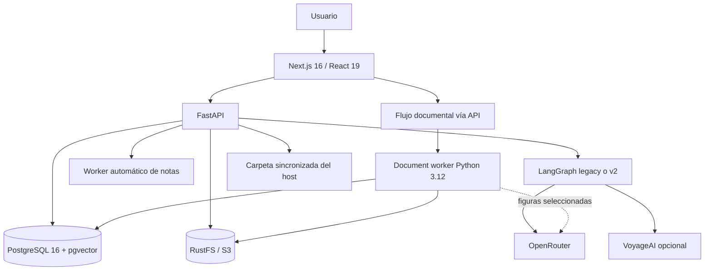

# Concat Notes

Suite de aprendizaje para capturar material de cursos, convertirlo en notas estructuradas, mantener glosarios y flashcards, estudiar con repetición espaciada y exportar el conocimiento a Markdown. Combina procesamiento local determinista con modelos consumidos mediante OpenRouter.

## Capacidades actuales

- **Notas:** entrada manual de transcripciones, resúmenes, notas propias, código, comandos e imágenes; cola editable y archivo por curso.
- **Documentos:** importación de PDF y EPUB completos, por capítulos/subcapítulos o por rangos físicos de páginas PDF; vista previa y confirmación antes de crear notas.
- **Flashcards:** índice propio compatible con el Markdown de Spaced Repetition, filtros, edición, estudio, historial y exportación CSV o Anki `.apkg`.
- **Sincronización:** un Markdown concatenado por curso en una carpeta montada del host, con nombres normalizados, hashes y resolución explícita de conflictos.
- **Agente:** síntesis pedagógica, recuperación histórica por curso, glosario con términos principales en inglés, flashcards y reparación de Mermaid.
- **Administración:** selección de modelos por función, metas de estudio, embeddings, respaldo y restauración de PostgreSQL y RustFS.

## Arquitectura



### Servicios de Docker Compose

| Servicio | Contenedor | Función | Puerto |
|---|---|---|---|
| `frontend` | `proyecto_notas_frontend` | Interfaz Next.js | `3000` |
| `backend` | `proyecto_notas_backend` | API, agente y worker de notas | `8000` |
| `document-worker` | `proyecto_notas_document_worker` | Parsing/OCR persistente de PDF y EPUB | interno |
| `db` | `proyecto_notas_db` | PostgreSQL y pgvector | `5432` |
| `rustfs` | `proyecto_notas_storage` | Objetos S3 | `9000`, consola `9001` |

PostgreSQL usa `pgdata` y RustFS usa `rustfsdata`. Recrear los servicios de aplicación no borra esos datos. `docker compose down -v` sí elimina los volúmenes y no debe usarse durante una actualización normal.

## Flujos principales

```text
Entrada manual o borrador documental
  -> raw_notes (pending)
  -> análisis de imágenes ordinarias
  -> pipeline LangGraph seleccionado
  -> processed_notes.structured_markdown
  -> memoria/embeddings, glosario y flashcards
  -> concatenación y sincronización opcional
```

La interfaz permite procesar inmediatamente. El worker del backend también procesa pendientes cuando hay al menos tres o cuando la más antigua supera diez minutos.

Para documentos:

```text
Subida -> RustFS -> inspección local -> selección del usuario
       -> extracción local -> visión remota opcional
       -> borrador editable -> confirmación -> raw_notes
```

El `document-worker` usa PyMuPDF, EbookLib, BeautifulSoup, Pillow y Tesseract. El archivo completo no se envía al proveedor de IA. OpenRouter sólo recibe figuras candidatas en los perfiles Equilibrado/Preciso y el texto cuando se ejecuta la síntesis normal. El perfil Local evita visión documental remota.

## Agente y modelos

Las preferencias de modelos viven en `user_settings`:

| Rol | Responsabilidad |
|---|---|
| `synthesis` | Cuerpo pedagógico y redacción final |
| `query_expansion` | Consultas RAG, evidencia, entidades y suplementos |
| `image_analysis` | Imágenes añadidas a notas manuales |
| `document_vision` | Figuras extraídas de PDF/EPUB |

OpenRouter transporta generación y visión. VoyageAI es opcional para embeddings de 1024 dimensiones; sin credencial se conservan vectores dummy marcados para reprocesamiento.

## Inicio rápido

Requisito principal: Docker con Compose. Node.js y `uv` sólo son necesarios para desarrollo fuera de Docker.

1. Crea `backend/.env` desde `backend/.env.template`.
2. Opcionalmente crea `.env` en la raíz y define `NOTES_SYNC_PATH`.
3. Ejecuta:

```bash
docker compose up --build -d
```

- Aplicación: <http://localhost:3000>
- API y Swagger: <http://localhost:8000/docs>
- Consola RustFS: <http://localhost:9001>

```bash
docker compose ps
docker compose logs -f backend document-worker
docker compose down                 # conserva los volúmenes
```

## Desarrollo y pruebas

```bash
cd backend
uv sync --frozen
uv run python -m unittest discover -s tests -q

cd ../document-worker
uv sync --frozen
uv run python -m unittest -q test_worker.py

cd ../frontend
corepack enable
pnpm install --frozen-lockfile
pnpm build
```

## Persistencia y sincronización

- Originales y recursos documentales: RustFS bajo `documents/{document_id}/...`.
- Notas, configuraciones, trabajos y estados: PostgreSQL.
- Backups ZIP: dump de PostgreSQL y objetos de RustFS.
- Sincronización: `/sync` en backend, montado desde `${NOTES_SYNC_PATH:-./synced-notes}`.
- Archivos: curso normalizado sin tildes ni puntuación y con espacios convertidos a `-`.
- El Markdown exportado no contiene marcadores internos de concatenación.

## Estructura y documentación

```text
Concat-notes/
├── backend/                 FastAPI, agente, worker de notas y administración
├── document-worker/         Parser PDF/EPUB aislado en Python 3.12
├── frontend/                Next.js App Router
├── db/                      Esquema y migraciones aditivas
├── docs/                    Arquitectura técnica del agente
├── synced-notes/            Salida generada; no es documentación fuente
└── docker-compose.yml       Orquestación de cinco servicios
```

- [Backend](backend/README.md)
- [Frontend](frontend/README.md)
- [Base de datos](db/README.md)
- [Worker documental](document-worker/README.md)
- [Agente y memoria](docs/agent-architecture.md)
- [Handoff documental y estado actual](DOCUMENT_PROCESSING_HANDOFF.md)
- [Planes futuros](PLANES-A-FUTURO.md)
