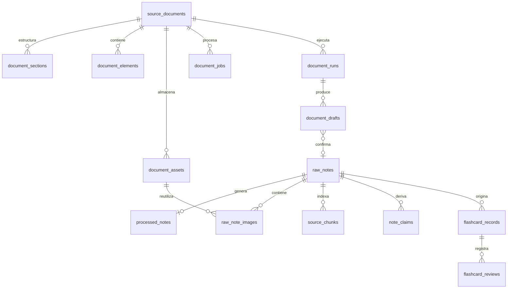

# Base de datos

PostgreSQL 16 con pgvector es la fuente de verdad para notas, configuración, memoria, flashcards, sincronización y trabajos documentales. Los binarios viven en RustFS; PostgreSQL conserva claves y relaciones.

## Persistencia y migraciones

Docker Compose monta `pgdata` en `/var/lib/postgresql/data`. Los scripts de inicialización sólo corren al crear un volumen vacío:

```text
init.sql
migrate_knowledge_v2.sql
migrate_local_sync.sql
migrate_flashcards_suite.sql
migrate_document_processing.sql
```

Para una base existente, aplicar la migración necesaria explícitamente después de un backup. Hay migraciones históricas adicionales que no deben reaplicarse sin revisar el esquema.

## Dominios

| Dominio | Tablas principales |
|---|---|
| Notas | `raw_notes`, `processed_notes`, `raw_note_images`, `note_chunks` |
| Estudio | `study_logs`, `user_settings` |
| Glosario | `course_glossaries` |
| Memoria v2 | `source_chunks`, `note_claims`, `generation_artifacts`, `knowledge_index_states` |
| Flashcards | `flashcard_records`, `flashcard_reviews` |
| Sincronización | `local_sync_config`, `local_sync_courses` |
| Documentos | `source_documents`, `document_sections`, `document_elements`, `document_assets`, `document_jobs`, `document_runs`, `document_drafts` |

## Relaciones



`processed_notes.structured_markdown` es la salida pública canónica. Chunks, claims, artefactos, embeddings e índice de flashcards son derivados/reconciliables. Originales y assets documentales son canónicos en RustFS.

## Vectores y jobs

VoyageAI genera vectores de 1024 dimensiones; si no está disponible se almacena un vector dummy marcado. HNSW acelera distancia de coseno y los índices B-tree cubren estados, cursos, orden, vencimientos y jobs.

`document_jobs` conserva estado, etapa, progreso, heartbeat, reintentos y cancelación. El worker reclama filas con bloqueo transaccional. `document_runs` fija selección, perfil, modelo y presupuesto; `document_drafts` permite revisar antes de crear notas.

## Operación segura

```bash
docker compose exec db psql -U notes_user -d notes_db -c '\dt'
docker compose exec backend python scripts/manage_db.py backup
```

- No ejecutar `docker compose down -v` salvo que se pretenda borrar PostgreSQL y RustFS.
- Renombrar/eliminar cursos mediante la API para mantener relaciones y derivados.
- Restaurar reemplaza estado material y exige backup y confirmación.
