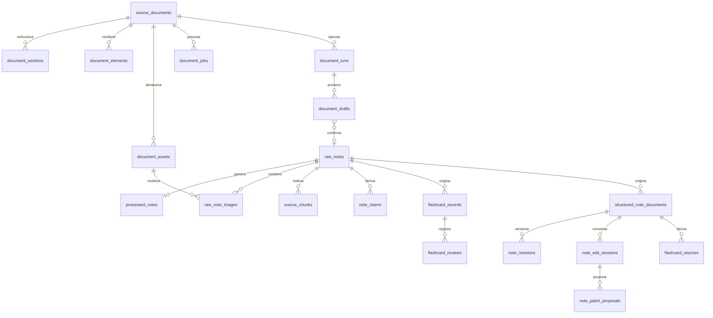

# Base de datos

PostgreSQL 16 con pgvector es la fuente de verdad para notas, configuración, memoria, flashcards, sincronización y trabajos documentales. Los binarios viven en RustFS; PostgreSQL conserva claves y relaciones.

Estado verificado: 10 de octubre de 2026. El esquema efectivo se define en SQL y `backend/app/models.py`; no hay una migración ORM automática equivalente a Alembic.

## Persistencia y migraciones

Docker Compose monta `pgdata` en `/var/lib/postgresql/data`. Los scripts de inicialización sólo corren al crear un volumen vacío:

```text
init.sql
migrate_knowledge_v2.sql
migrate_local_sync.sql
migrate_flashcards_suite.sql
migrate_document_processing.sql
migrate_structured_notes.sql
migrate_regeneration_jobs.sql
migrate_global_agent.sql
```

Sobre una base existente, `db-migrate` aplica con `ON_ERROR_STOP` las migraciones estructuradas, regeneraciones y agente global antes de arrancar backend/document-worker. No aplica todas las migraciones históricas: una instalación anterior que carezca de conocimiento, sincronización, tarjetas o documentos requiere revisar/aplicar sus SQL tras un backup. Los scripts de inicialización no se ejecutan otra vez al recrear el contenedor.

## Dominios

| Dominio | Tablas principales |
|---|---|
| Notas | `raw_notes`, `processed_notes`, `raw_note_images`, `note_chunks` |
| Estudio | `study_logs`, `user_settings` |
| Glosario | `course_glossaries` |
| Memoria v2 | `source_chunks`, `note_claims`, `generation_artifacts`, `knowledge_index_states` |
| Flashcards | `flashcard_records`, `flashcard_reviews` |
| Sincronización | `local_sync_config`, `course_sync_states` |
| Documentos | `source_documents`, `document_sections`, `document_elements`, `document_assets`, `document_jobs`, `document_runs`, `document_drafts` |
| Cornell | `workspaces`, `structured_note_documents`, `note_revisions`, `note_collections` |
| Editor IA | `note_edit_sessions`, `note_edit_messages`, `note_patch_proposals` |
| Compatibilidad de estilo | `note_style_profiles`, `note_style_examples` (no implican una metodología activa de generación) |
| Origen de tarjetas Cornell | `flashcard_sources` |
| Regeneración | `regeneration_jobs` |
| Agente global | `agent_conversations`, `agent_messages`, `agent_runs` |

## Relaciones



`structured_note_documents.document_json` es la fuente editable de Cornell. Las clases generadas conservan Markdown clásico en `processed_notes.structured_markdown` y una representación/revisión compatible. Los índices se reconstruyen; no considerar una edición del chunk como edición de la fuente ni como exclusión permanente. Originales/assets son canónicos en RustFS. Revisiones y huellas protegen cambios concurrentes; una regeneración confirma cada clase y sus derivados en una transacción.

## Vectores y jobs

VoyageAI genera vectores de 1024 dimensiones; si no está disponible se almacena un vector dummy marcado. HNSW acelera distancia de coseno y los índices B-tree cubren estados, cursos, orden, vencimientos y jobs.

`document_jobs` conserva estado, etapa, progreso, heartbeat, reintentos y cancelación. El worker reclama filas con bloqueo transaccional. `document_runs` fija selección, perfil, modelo y presupuesto; `document_drafts` permite revisar antes de crear notas.

`regeneration_jobs` conserva selección, componentes, instrucciones, progreso y resultados. `agent_runs` conserva ejecución y propuestas verificables. Reiniciar no convierte trabajos interrumpidos en regeneraciones facturables automáticas; las conversaciones y resultados ya guardados permanecen.

## Operación segura

```bash
docker compose exec db psql -U notes_user -d notes_db -c '\dt'
# En el host (el script requiere Docker):
cd backend
uv run python scripts/manage_db.py backup
```

- No ejecutar `docker compose down -v` salvo que se pretenda borrar PostgreSQL y RustFS.
- Renombrar/eliminar cursos mediante la API para mantener relaciones y derivados.
- Restaurar reemplaza estado material y exige backup y confirmación.

El script respalda PostgreSQL, no los objetos RustFS; el ZIP de la API sí incluye ambos. Los nombres reales de volúmenes dependen del proyecto Compose: conservarlos al actualizar. Véanse [RAG y regeneración](../docs/rag-maintenance.md) y [agente global](../docs/global-agent.md).
