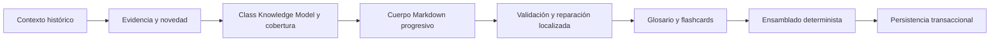

# Arquitectura del agente y memoria

Concat Notes separa adquisición determinista de evidencia e interpretación por IA. El agente no parsea PDF/EPUB: recibe una `raw_note` manual o confirmada desde un borrador documental.

Estado contrastado: 10 de octubre de 2026. Hay tres contratos agénticos distintos: generación de clases, editor atómico Cornell y agente global del espacio de notas. No comparten automáticamente prompts, herramientas, reintentos ni presupuestos.

## Frontera

```text
Fuentes -> evidencia y novedad -> cobertura -> Markdown de clase -> derivados
```

- **Canónico:** `raw_notes`, originales/assets en RustFS y `structured_note_documents.document_json` para notas Cornell.
- **Derivado:** chunks, embeddings, claims, glosario compilado, índice de flashcards y métricas.
- **Determinista:** placeholders, validadores, ensamblado, parsing documental y sincronización.
- **Remoto:** generación/visión por OpenRouter y embeddings por VoyageAI si está configurado.

## Pipeline v2



1. `context`: recupera clases anteriores del mismo curso mediante orden estable.
2. `evidence`: clasifica afirmaciones como `NEW`, `EXTENDS`, `REPEATS`, `APPLIES`, `CLARIFIES` o `CONTRADICTS`.
3. `knowledge_model`: separa conceptos, métodos, código, imágenes y aportaciones del usuario.
4. `body`: genera el cuerpo Markdown clásico con contexto inicial y desarrollo temático, priorizando el delta de conocimiento. Mis notas conserva Cornell; no es el formato solicitado al generador de clases.
5. Se validan headings, cercas y contenido de simulación. Se normalizan headings reconocibles sin tocar código; ante otro error de presentación se permite una reparación localizada. No hay un nodo Critic separado en el grafo actual.
6. `mermaid_repair`: sustituye únicamente bloques inválidos.
7. `supplements`: genera delta de glosario y flashcards deduplicadas.
8. `assemble`: crea la proyección pública compatible.
9. El worker persiste Markdown y derivados v2 transaccionalmente y mantiene el documento/revisión compatible. La regeneración selectiva confirma por clase los componentes solicitados y sus derivados; no implica una sola transacción para todo el curso.

## Agente editor

El editor usa preservation-by-default. Puede inspeccionar outline, bloques, relaciones y fuentes, pero sólo devuelve operaciones semánticas. El backend valida la revisión base y el usuario aprueba cada operación antes de crear una revisión. Una propuesta sobre una revisión antigua pasa a `stale`.

En Mis notas, el editor solicita `response_format: json_schema` y valida también estructura, operaciones, IDs, alcance y documento resultante. Si una respuesta falla, se devuelve al mismo modelo una corrección interna sobre la misma revisión: hasta cinco intentos y un presupuesto temporal comprobado entre llamadas. Los reintentos no generan mensajes públicos, propuestas adicionales ni cambios parciales. Si el proveedor rechaza el formato estructurado, se mantiene el modelo y se utiliza el protocolo JSON validado localmente. El soporte depende del endpoint, como explica [OpenRouter](https://openrouter.ai/docs/guides/features/structured-outputs).

Si se agota la recuperación, se guarda una respuesta conversacional sin operaciones y sin errores técnicos de JSON, dejando intacta la nota. No se promete recuperación infinita ni se transforma una salida inválida en una edición. Fallos de conexión o credenciales no se confunden con errores de formato. El historial excluye los antiguos mensajes marcados como errores al construir el contexto del modelo. Las respuestas describen propuestas, no cambios ya aplicados.

Los títulos del glosario priorizan el concepto en inglés. La explicación se redacta en español y la traducción aparece sólo entre paréntesis.

## Pipeline legacy

El pipeline legacy conserva recuperación, filtro de glosario, herramientas, entidades, síntesis, validación Mermaid/flashcards y extracción de glosario. Puede seleccionarse con `user_settings.generation_pipeline_version` sin migrar notas.

«Legacy» es una alternativa explícita de compatibilidad, no un fallback automático tras un error v2 en `generate_note_state`. No se guarda una salida local de simulación como éxito. La antigua Metodología de composición no está activa; las tablas de perfiles/ejemplos permanecen por compatibilidad y no prueban recuperación de ejemplos editoriales implementada.

## Agente global y herramientas

La sección `/agent` consulta mediante `WorkspaceTools`: notas, fuentes, documentos Cornell, chunks, tarjetas, glosario, progreso y candidatos de duplicación. Las operaciones se preparan en memoria, verifican lectura previa y alcance por curso y se presentan con diferencias. Aplicar comprueba huellas/revisiones antes de confirmar todas las modificaciones en una transacción. No permite shell, SQL arbitrario ni acceso a archivos del host. Véase [contrato del agente global](global-agent.md).

## Cornell y proyección lineal

Mis notas guarda bloques Markdown con IDs persistentes, relaciones muchos-a-muchos y grid compartido. Los separadores alinean grupos de ambas columnas sin coordenadas libres. En Markdown, Desarrollo define el orden; cada pista relacionada aparece una vez antes del primer desarrollo asociado, con orden visual entre pistas. Las pistas sin relación cierran la sección tras un divider. No se imprimen IDs ni etiquetas de columna. La detección de H1 crea secciones; el renderer y los patches son deterministas, no decisiones del modelo.

## RAG y memoria

- `source_chunks`: transcripción, notas propias, código, comandos e imágenes descritas.
- `note_claims`: afirmaciones atómicas, evidencia y relación histórica.
- `generation_artifacts`: cuerpo, glosario, tarjetas, manifiesto y métricas.
- `knowledge_index_states`: checkpoint reanudable.

Los chunks de fuente usan ventanas aproximadas de 1600 caracteres con 200 de solapamiento. Los chunks de Markdown usan ventanas de 1800 con 150 de solapamiento dentro de cada sección, sin descartar su final. Los vectores Voyage tienen 1024 dimensiones. La recuperación combina búsqueda densa y lexical, filtra por curso y excluye clases actuales y futuras. Las afirmaciones tienen un canal lexical propio; la diversidad por clase se aplica a los fragmentos de fuente, no a costa de ocultar afirmaciones relevantes. El contexto tiene presupuestos de tamaño y las tarjetas históricas completas se usan para validación local, no se envían todas al modelo.

## Roles

| Rol | Consumidores |
|---|---|
| `synthesis` | Síntesis legacy/v2 |
| `query_expansion` | RAG, evidencia, entidades y suplementos |
| `image_analysis` | Imágenes de Entrada manual |
| `document_vision` | Figuras del document-worker |

El resolvedor registra modelo solicitado, efectivo, transporte y fallback. Las claves no deben entrar en estados LangGraph, jobs, manifests ni respuestas públicas.

## Imágenes y portabilidad

Los placeholders `&"imagen:X"`, `&"codigo:X"` y `&"comando:X"` controlan la posición de evidencia manual. EPUB conserva el orden XHTML de figuras; PDF conserva su página, pero actualmente las añade al final del bloque de esa página.

La cabecera visible se añade después del frontmatter; las tarjetas mantienen sintaxis jerárquica portable; la sincronización elimina marcadores internos y normaliza nombres/decks.

## Operación

```bash
curl http://localhost:8000/api/knowledge/status
docker compose exec backend python scripts/manage_db.py backfill-knowledge --all --resume --defer-embeddings --embedding-batch-size 64
curl -X PUT http://localhost:8000/api/settings/generation-pipeline -H 'Content-Type: application/json' -d '{"version":"legacy"}'
```

El backfill no reescribe Markdown histórico. Los fallos remotos deben producir degradación explícita o fallback, nunca contenido atribuido silenciosamente.
## Optimización de evidencia y llamadas

La extracción individual conserva el contrato de novedad (`NEW`, `EXTENDS`, `REPEATS`, `APPLIES`, `CLARIFIES`, `CONTRADICTS`). `evidence_inputs.py` prepara páginas de unas 8000 letras, sin solapamiento ni truncamiento, divididas en fragmentos numerados. El modelo devuelve referencias a estos fragmentos: el backend copia el texto literal y su tipo de fuente. No se pide al modelo redactar citas. Una huella conservadora de fuentes, orden, historial, modelo configurado y versión permite reutilizar extracción vigente. No se impone una cuota de afirmaciones.

`generation_runtime.py` recibe contenido en streaming interno, sin guardar parciales, y aplica presupuestos por tarea/tamaño: evidencia 90–150 segundos, glosario 150–180, flashcards 90–150, síntesis 150–240 y reparación del cuerpo 120–180. Distingue espera del primer texto, inactividad y límite total; los keepalives no cuentan como avance y el límite HTTP de lectura ya no queda fijo en 45 segundos. Los reintentos internos del SDK están desactivados. El JSON se valida y tiene como máximo dos intentos por operación; se solicita JSON Schema donde el catálogo indica soporte. La síntesis usa razonamiento bajo; DeepSeek auxiliar permite desactivarlo, mientras Gemini Flash Lite requiere esfuerzo `minimal`, también en un fallback. Una respuesta truncada, interrumpida o sin confirmación de finalización se rechaza. La indisponibilidad temporal auxiliar permite un fallback explícito y una pausa de cinco minutos del proveedor fallido, sin cambiar la selección del usuario.

Glosario y flashcards se generan en paralelo, tanto en generación como en regeneración. La cantidad de tarjetas es un máximo, no una cuota: una clase de repaso puede producir cero, con motivo observable. Se filtran definiciones ya existentes y tarjetas duplicadas; se conservan aplicaciones y ampliaciones. Los embeddings se agrupan y reutilizan únicamente para texto idéntico. Las afirmaciones idénticas conservan su ID para evitar romper referencias históricas.

`regeneration.generate_selection` registra duración acumulada por fase. Un callback persiste progreso en el trabajo sin confirmar cambios parciales en la nota y serializa snapshots de solicitudes paralelas. La interfaz de clases muestra fase, tiempos, páginas, llamadas, tokens, tarjetas obtenidas, fallback y reutilización, además del primer texto, caracteres recibidos, modelo efectivo y tope por llamada, con actualizaciones cada cinco segundos durante la espera/generación; advierte si hay clases anteriores sin afirmaciones indexadas. Véase [mantenimiento RAG](rag-maintenance.md) y [validación de eficiencia](generation-efficiency.md) para alcance y limitaciones.

Estas métricas no demuestran precisión absoluta ni distinguen por sí solas cola del proveedor de razonamiento interno. Reindexar puede recrear fragmentos retirados manualmente. Los locks son internos al proceso y no habilitan por sí solos múltiples réplicas coordinadas.
