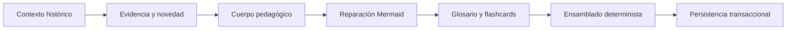

# Arquitectura del agente y memoria

Concat Notes separa adquisición determinista de evidencia e interpretación por IA. El agente no parsea PDF/EPUB: recibe una `raw_note` manual o confirmada desde un borrador documental.

## Frontera

```text
Fuentes -> evidencia canónica -> agente -> Markdown procesado -> derivados
```

- **Canónico:** `raw_notes`, originales/assets en RustFS y `processed_notes.structured_markdown`.
- **Derivado:** chunks, embeddings, claims, glosario compilado, índice de flashcards y métricas.
- **Determinista:** placeholders, validadores, ensamblado, parsing documental y sincronización.
- **Remoto:** generación/visión por OpenRouter y embeddings por VoyageAI si está configurado.

## Pipeline v2



1. `context`: recupera clases anteriores del mismo curso mediante orden estable.
2. `evidence`: clasifica afirmaciones como `NEW`, `EXTENDS`, `REPEATS`, `APPLIES`, `CLARIFIES` o `CONTRADICTS`.
3. `body`: el modelo principal redacta el cuerpo.
4. `mermaid_repair`: sustituye únicamente bloques inválidos.
5. `supplements`: genera delta de glosario y flashcards deduplicadas.
6. `assemble`: añade cabecera visible, cuerpo y suplementos determinísticamente.
7. El worker persiste resultado, artefactos, memoria e índices.

Los títulos del glosario priorizan el concepto en inglés. La explicación se redacta en español y la traducción aparece sólo entre paréntesis.

## Pipeline legacy

El fallback legacy conserva recuperación, filtro de glosario, herramientas, entidades, síntesis, validación Mermaid/flashcards y extracción de glosario. Puede seleccionarse con `user_settings.generation_pipeline_version` sin migrar notas.

## RAG y memoria

- `source_chunks`: transcripción, notas propias, código, comandos e imágenes descritas.
- `note_claims`: afirmaciones atómicas, evidencia y relación histórica.
- `generation_artifacts`: cuerpo, glosario, tarjetas, manifiesto y métricas.
- `knowledge_index_states`: checkpoint reanudable.

Los chunks usan ventanas aproximadas de 1600 caracteres con 200 de solapamiento. Los vectores Voyage tienen 1024 dimensiones. La recuperación filtra por curso, excluye la nota actual y limita la contribución por clase.

## Roles

| Rol | Consumidores |
|---|---|
| `synthesis` | Síntesis legacy/v2 |
| `query_expansion` | RAG, evidencia, entidades y suplementos |
| `image_analysis` | Imágenes de Entrada manual |
| `document_vision` | Figuras del document-worker |

El resolvedor registra modelo solicitado, efectivo, transporte y fallback. Las claves no deben entrar en estados LangGraph, jobs, manifests ni respuestas públicas.

## Imágenes y portabilidad

Los placeholders `&"imagen:X"`, `&"codigo:X"` y `&"comando:X"` controlan la posición de evidencia manual. EPUB conserva el orden XHTML de figuras; PDF conserva su página, pero actualmente las añade al final del bloque de esa página.

La cabecera visible se añade después del frontmatter; las tarjetas mantienen sintaxis jerárquica portable; la sincronización elimina marcadores internos y normaliza nombres/decks.

## Operación

```bash
curl http://localhost:8000/api/knowledge/status
docker compose exec backend python scripts/manage_db.py backfill-knowledge --all --resume --defer-embeddings --embedding-batch-size 64
curl -X PUT http://localhost:8000/api/settings/generation-pipeline -H 'Content-Type: application/json' -d '{"version":"legacy"}'
```

El backfill no reescribe Markdown histórico. Los fallos remotos deben producir degradación explícita o fallback, nunca contenido atribuido silenciosamente.
